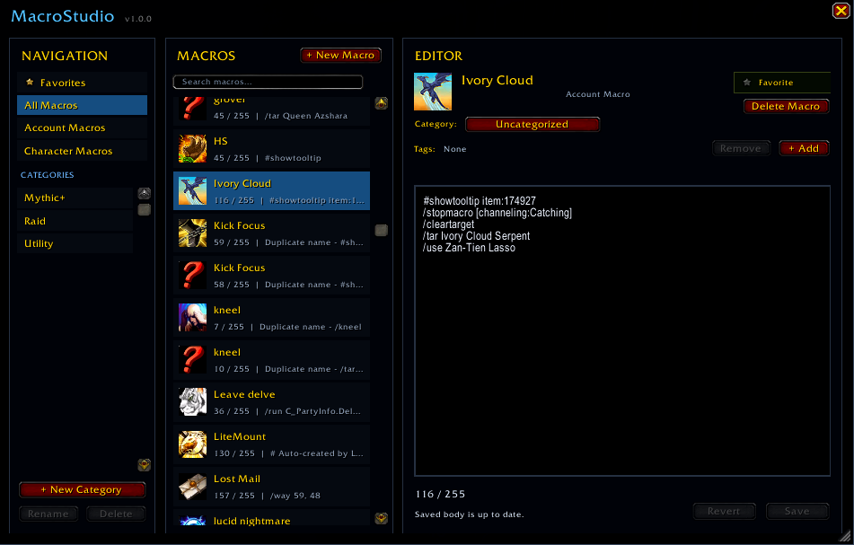
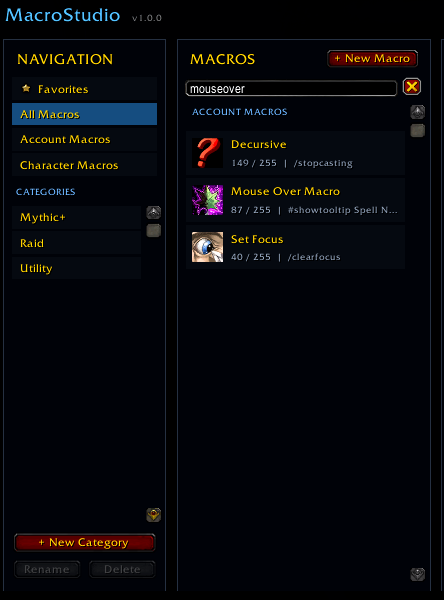
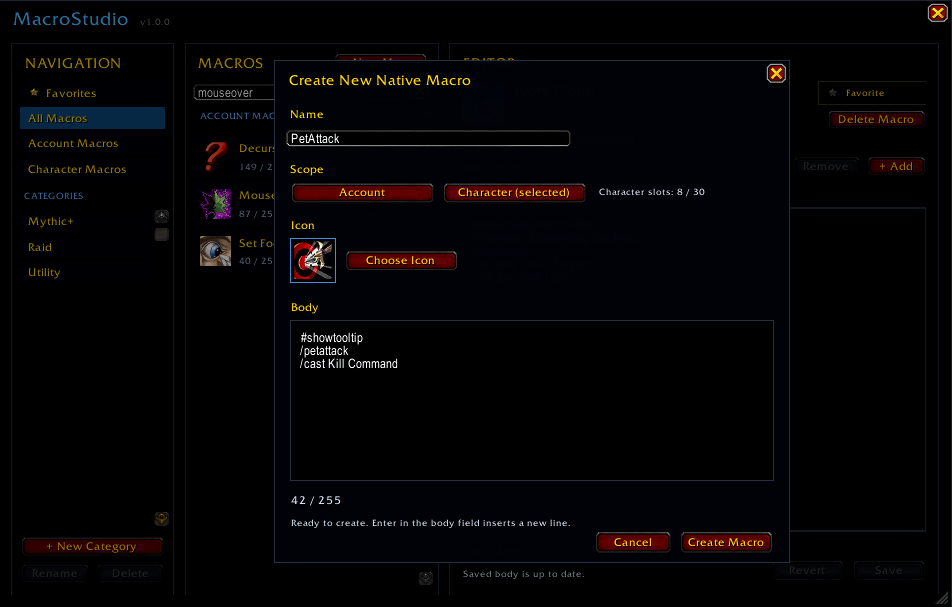

# MacroStudio

**A bigger, searchable macro editor with a shared library for all your characters.**

MacroStudio gives you more room to edit, search, and organize your WoW macros. Keep your native Account and Character macros together, or create shared MacroStudio macros without using native macro slots.

*Your Account, Character, and shared MacroStudio macros, all in one place.*

## Features

- **Big searchable editor:** Work comfortably in a resizable multiline editor and search names, bodies, categories, and tags.
- **Account + Character macros:** Browse and manage both scopes in one window.
- **Shared MacroStudio macros:** Store macros across all your characters without the native slot cap. Macro bodies retain the 255-character limit.
- **Inline keybindings:** Bind shared macros per character using a keyboard key, middle/extra mouse button, or scroll direction. Left-click the Keybind button to capture, Esc to cancel, or right-click to clear.
- **Categories, tags, and Favorites:** Keep a large macro collection easy to navigate.
- **Edit name, icon, and body:** Update every part of an existing native macro together.
- **Create and delete macros:** Manage native WoW macros without returning to Blizzard's small editor.
- **Action-bar workflow:** Drag list entries or the editor icon onto action bars and see which macros are currently **On Bar**. Shared macros use one reusable linked native slot per macro placed on a standard bar; direct keybindings use no native slots.
- **Cross-character library:** Browse read-only snapshots from your other characters and copy them to Current Character, Account Macros, or MacroStudio Macros.
- **Macro checks:** Inspect line-specific hints for common command and condition problems while editing. Checks never rewrite your macro or block Save.
- **Icon search:** Find raid markers, icon file IDs, full ability names, or partial spellbook ability names.
- **Flexible slash commands:** Optionally use MacroStudio for `/m` and `/macro`, with `/ms blizzard` always available for Blizzard's original window.
- **Quick launchers:** Open MacroStudio from its minimap button or WoW's AddOn Compartment.
- **Persistent Settings:** Control slash-command takeover and minimap visibility from one compact panel.
- **Named color styles:** Choose **Settings → Color Style** for Warcraft (default), Legacy, Emerald, Violet, or Ember, then **Reload UI**. Legacy includes the original blue/gray design. Your macros and organization data are kept.
- **Combat-safe editing:** Drafts stay intact while protected macro changes remain blocked in combat.

## Find Macros Fast

*Find a macro instantly, even by text inside the macro body.*

## Create Macros

*Create Account, Character, or shared MacroStudio macros in one window.*

## Coming Soon!

- Import and export your MacroStudio setup.
- Roll back mistakes with macro backups and history.

Want the full plan? See the [roadmap](ROADMAP.md).

## Usage

Open MacroStudio with `/ms` or `/macrostudio`.

With slash-command takeover enabled, `/m` and `/macro` also open MacroStudio. Use `/ms blizzard` for Blizzard's original macro window and `/ms settings` for Settings.

## Installation

For World of Warcraft Retail 12.1.5 (Interface `120105`).

1. Download the latest ZIP from [GitHub Releases](https://github.com/Baeleaf/MacroStudio/releases).
2. Extract `MacroStudio` into `World of Warcraft\_retail_\Interface\AddOns\`.
3. Restart WoW and type `/ms`.

## Feedback

Found a bug or have an idea? [Tell me through GitHub Issues](https://github.com/Baeleaf/MacroStudio/issues).

## More

[Roadmap](ROADMAP.md) · [Changelog](CHANGELOG.md) · [Contributing](CONTRIBUTING.md) · [MIT License](LICENSE)
